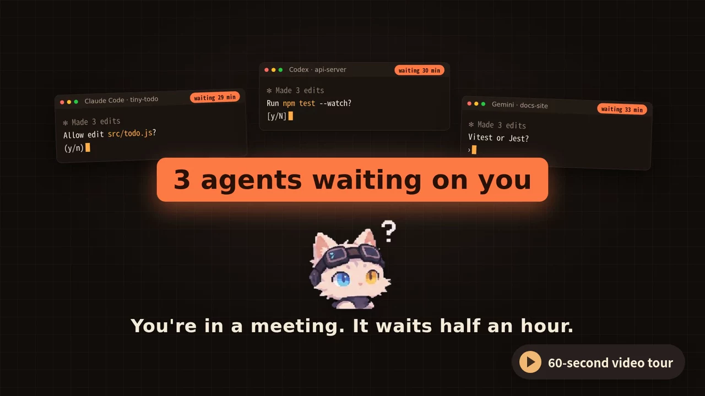
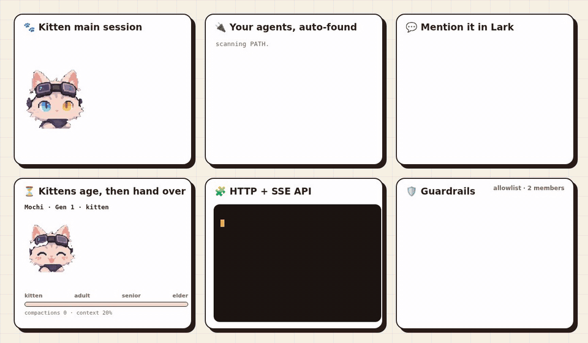

<div align="center">

<picture>
  <source media="(prefers-color-scheme: dark)" srcset="docs/assets/readme/agentdock-logo-dark.svg">
  
</picture>

English · [简体中文](README_zh.md)

[](https://www.npmjs.com/package/@agent-dock/cli)
[](https://nodejs.org)
[](https://agentclientprotocol.com)
[](LICENSE)

**Mention it in Lark, type in the web console, or call the HTTP API. Claude Code and Codex get to work in your local workspace, and you watch every step live.**

[Get started](#get-started) · [Features](#features) · [How it works](#how-it-works) · [Full guide (Chinese)](docs/guide.zh-CN.md)

</div>

<br>

<a href="docs/assets/readme/agentdock-intro-en.mp4"></a>

<p align="center"><sub>Click the cover for a 60-second video tour. The app screens inside come from a real AgentDock run.</sub></p>

## Features

<p align="center"></p>

- 🐾 **Adopt a kitten as your main session.** Say what you need; it splits the work into sticky notes, hands each one to a side session, follows up, reviews the results, and only pings you when it needs you.
- ⏳ **Kittens grow old, then hand over.** As the main session piles up context and compactions, the kitten ages from kitten to elder. When it gets tired it asks you to start a handoff: a new kitten is born and inherits the unfinished notes, so long-running work never chokes on a bloated context.
- 🔌 **Use the agents you already have.** Claude Code, Codex, Cursor, Gemini, opencode, Trae, Pi and other ACP agents are discovered automatically. Only CLIs actually installed on your machine show up.
- 💬 **Mention it in Lark.** DM the bot or @ it in a group; progress and results stream into a single card. Several agents can find each other and hand off work in the same group.
- 🖥️ **One web console for everything.** Streaming Markdown, tool calls, permission requests and terminal output are stored in SQLite. Queue, interrupt or retry with one click, and scan a QR code to continue from your phone.
- 🔁 **Service CLI with recursive self-improvement (RSI).** A full daemon lifecycle (`start` / `stop` / `restart` / `update` / `autostart`) that agents drive too. `agent-dock dev up` gives them an isolated sandbox to improve AgentDock itself and verify end to end, without ever restarting the daemon they run in. HTTP + SSE API included.
- 🛡️ **Guardrails in the UI.** Block risky commands, allowlist members and protect the console without touching config files.

## Get started

Requires Node.js 22.13+.

```bash
npm i -g @agent-dock/cli@latest

cd /path/to/your/project
agent-dock start      # runs in the background; open http://127.0.0.1:4310
```

Everyday commands:

```bash
agent-dock status     # PID, address and log path
agent-dock restart
agent-dock stop
agent-dock update     # update and restart the background service
agent-dock            # no subcommand: run in the foreground
```

Rather not install Node? Grab the [desktop app](https://github.com/coding-ax/agent-dock/releases) for macOS or Windows.

<details>
<summary><b>Run from source</b></summary>

```bash
pnpm install
cp .env.example .env
pnpm dev              # Fastify + Vite on http://127.0.0.1:4311
pnpm test && pnpm typecheck
pnpm build
```

</details>

<details>
<summary><b>Connect a Lark (Feishu) bot</b></summary>

Open **Lark settings → Create bot by QR code** in the bottom-left corner, scan with Lark to authorize, then pick a workspace and an agent. After that, DM the bot or @ it in a group. Permissions, group collaboration and risky-command gates are covered in the [full guide](docs/guide.zh-CN.md#飞书接入) (Chinese).

</details>

## How it works

```text
Lark / Web / HTTP  ──▶  AgentDock runtime  ──▶  acpx  ──▶  Claude Code · Codex · Gemini · …
                          │
                          └── SQLite: sessions, events, tool calls, permissions, all replayable
```

AgentDock embeds no vendor SDK. A pinned `acpx` runtime handles the ACP handshake, persistent sessions, reconnects, streaming, permission requests and process cleanup; AgentDock owns product state, normalized events, storage, the API and channels. If your agent speaks ACP, it plugs in.

> [!WARNING]
> AgentDock listens on `0.0.0.0` by default, so it is reachable on your LAN. The console has a single owner credential and no multi-user or tenant isolation. Use `--local-only` to keep it on this machine, and put HTTPS and real authentication in front before exposing it anywhere else.

## Docs

The full guide is written in Chinese: [Full guide](docs/guide.zh-CN.md) · [HTTP API](docs/guide.zh-CN.md#服务化接入) · [Lark](docs/guide.zh-CN.md#飞书接入) · [Custom agents](docs/guide.zh-CN.md#agent-发现与自定义-agent) · [CLI cheatsheet](docs/guide.zh-CN.md#命令行速查) · [Desktop app](apps/desktop/README.md) · [Contributing](AGENTS.md)

## License

[MIT](LICENSE)
