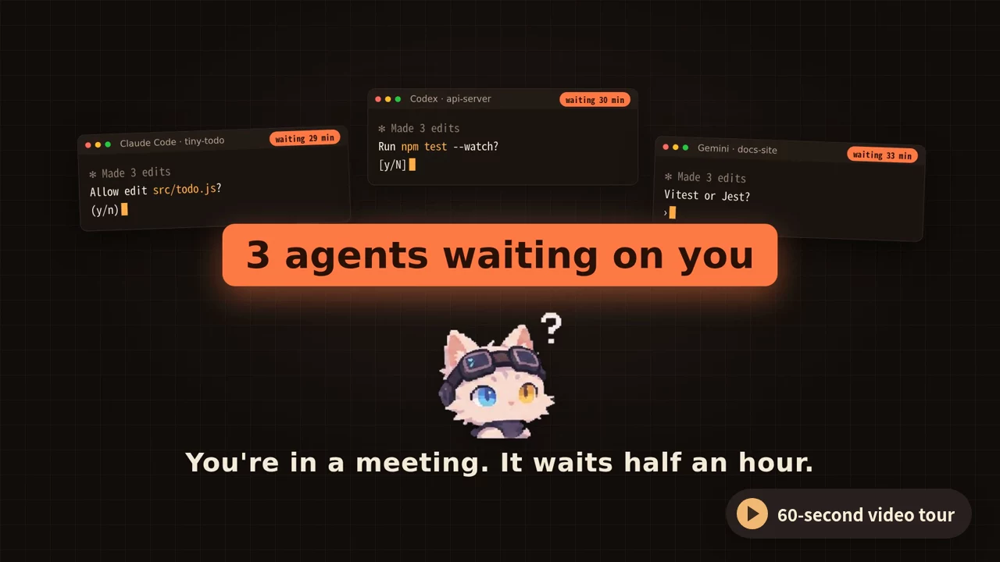
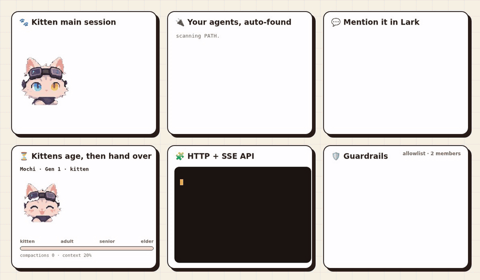

<div align="center">

<picture>
  <source media="(prefers-color-scheme: dark)" srcset="docs/assets/readme/agentdock-logo-dark.svg">
  
</picture>

[English](README.md) · 简体中文

[](https://www.npmjs.com/package/@agent-dock/cli)
[](https://nodejs.org)
[](https://agentclientprotocol.com)
[](LICENSE)

**飞书 @ 一下、Web 里说一句、HTTP 调一次 —— Claude Code、Codex 就在你的本地工作区开工，过程实时可见。**

[快速开始](#快速开始) · [能做什么](#能做什么) · [工作原理](#工作原理) · [完整手册](docs/guide.zh-CN.md)

</div>

<br>

<a href="docs/assets/readme/agentdock-intro-en.mp4"></a>

<p align="center"><sub>点击封面观看 60 秒视频导览，片中的界面截自真实运行的 AgentDock。</sub></p>

## 能做什么

<p align="center"></p>

- 🐾 **认领一只小猫当主会话。** 你只管说需求，它拆成便签、派给侧边会话去干、盯进度、逐条验收，有事才来找你。
- ⏳ **小猫会变老，会提醒你换代。** 主会话的上下文和压缩次数越攒越多，小猫就从幼猫长到老年；累了会主动请你发起交接，新猫出生并接手没做完的便签，长期运行也不会被臃肿的上下文拖垮。
- 🔌 **本机有什么 Agent 就用什么。** 自动发现 Claude Code、Codex、Cursor、Gemini、opencode、Trae、Pi 等 ACP Agent，只列出本机真装了 CLI 的。
- 💬 **飞书里直接 @ 它。** 私聊或群里 @ 机器人，过程和结果实时回写成一张卡片；多个 Agent 能在同一个群里互相发现、交接。
- 🖥️ **一个 Web 工作台看全部。** 流式 Markdown、工具调用、权限请求、终端输出都持久化在 SQLite；排队、中断、重试一键完成；手机扫码就能接着聊。
- 🔁 **一整套服务 CLI，能自我迭代。** `agent-dock` 以后台服务运行，`start`、`stop`、`restart`、`update`、开机 `autostart` 一应俱全；Agent 也用同一个 CLI 派活、注册定时任务、挂 watch、给会话发消息。`agent-dock dev up` 会用仓库构建产物起一个隔离沙箱（独立 HOME、数据库、端口），Agent 可以直接改 AgentDock 自己的代码并端到端验证，最后把一行升级命令交给你；CLI 会拦住它重启正在运行自己的 daemon。要接平台也有完整的 HTTP + SSE 接口，断线可续传。
- 🛡️ **门禁和白名单在界面里配。** 高危操作拦截、成员白名单、控制台访问凭证，不用改配置文件。

## 快速开始

需要 Node.js 22.13+。

```bash
npm i -g @agent-dock/cli@latest

cd /path/to/your/project
agent-dock start      # 后台启动，打开 http://127.0.0.1:4310
```

常用命令：

```bash
agent-dock status     # 查看 PID、地址、日志路径
agent-dock restart
agent-dock stop
agent-dock update     # 更新并重启后台服务
agent-dock            # 不带子命令：前台运行
```

不想装 Node？macOS 和 Windows 可以直接下载[桌面客户端](https://github.com/coding-ax/agent-dock/releases)。

<details>
<summary><b>从源码运行</b></summary>

```bash
pnpm install
cp .env.example .env
pnpm dev              # Fastify + Vite，访问 http://127.0.0.1:4311
pnpm test && pnpm typecheck
pnpm build
```

</details>

<details>
<summary><b>接入飞书机器人</b></summary>

打开左下角「飞书设置」→「扫码创建机器人」，用飞书扫码授权，再选好工作区和 Agent 就能用。之后私聊机器人或在群里 @ 它即可。权限清单、群协作和高危门禁见[完整手册 · 飞书接入](docs/guide.zh-CN.md#飞书接入)。

</details>

## 工作原理

```text
飞书 / Web / HTTP  ──▶  AgentDock 运行时  ──▶  acpx  ──▶  Claude Code · Codex · Gemini · …
                          │
                          └── SQLite：会话、事件、工具调用、权限，全部可回放
```

AgentDock 不内嵌任何供应商 SDK。ACP 握手、持久会话、重连、流式输出、权限请求和子进程清理交给固定版本的 `acpx` 运行时；AgentDock 负责产品状态、标准化事件、存储、API 和通道。所以只要你的 Agent 讲 ACP，就能接进来。

> [!WARNING]
> AgentDock 默认监听 `0.0.0.0`，局域网内可访问；控制台只有一层「所有者」凭证防护，没有多用户和租户隔离。只想本机访问用 `--local-only`，对外暴露请务必在前面加 HTTPS 和身份认证。

## 文档

[完整手册](docs/guide.zh-CN.md) · [HTTP API](docs/guide.zh-CN.md#服务化接入) · [飞书接入](docs/guide.zh-CN.md#飞书接入) · [自定义 Agent](docs/guide.zh-CN.md#agent-发现与自定义-agent) · [命令行速查](docs/guide.zh-CN.md#命令行速查) · [桌面客户端](apps/desktop/README.md) · [贡献指南](AGENTS.md)

## 许可证

[MIT](LICENSE)
